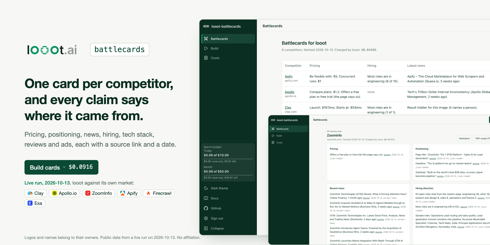

Logos and names belong to their owners. Public data from a live run on 2026-10-13. No affiliation.

# looot-battlecards

[](LICENSE) [](https://github.com/loootai/looot-battlecards/releases) [](https://docs.looot.ai)

Competitive battlecards from public data, with a source link and a fetch date next to every claim. Give it your product and 1 to 10 competitor domains. It reads each competitor's pricing page, homepage, careers page, news, tech stack, review snippets and ads through [looot](https://looot.ai) and writes one card per competitor as JSON, markdown and PDF-ready HTML.

An open-source alternative to Klue and Crayon. Neither publishes a starting price: on 2026-10-10 Klue's pricing page offered only "Get a demo" and Crayon's asked for an estimate request. Here a competitor costs about $0.015 in looot calls.

> **Security notice.** Versions 0.1.3 and older had no admin sign-in. Anyone who could reach a deployed web UI could read the stored cards, download them, and start paid looot runs on your token. If you run v0.1.3 or older on a reachable host, upgrade to v0.1.4 and set `BATTLECARDS_ADMIN_PASSWORD`. See [Securing a deployment](#securing-a-deployment).


<table>
<tr>
<td width="50%">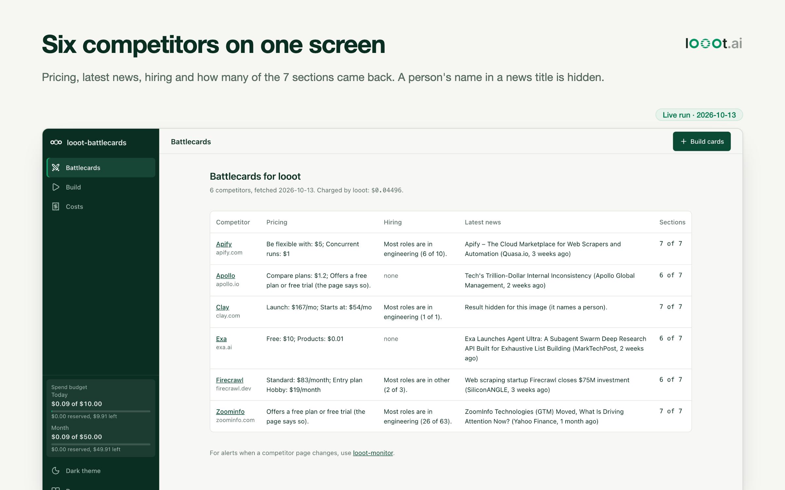</td>
<td width="50%">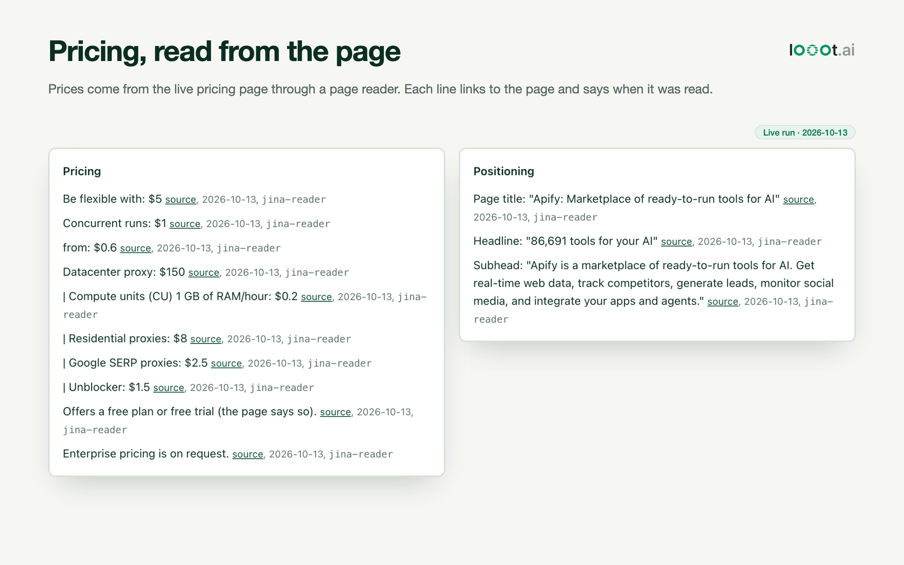</td>
</tr>
<tr>
<td>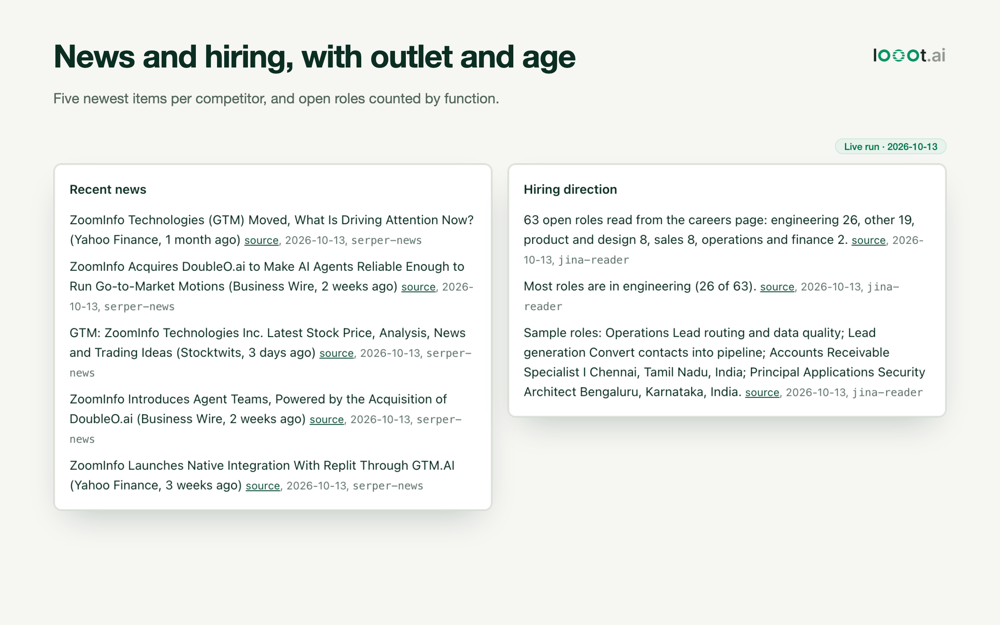</td>
<td>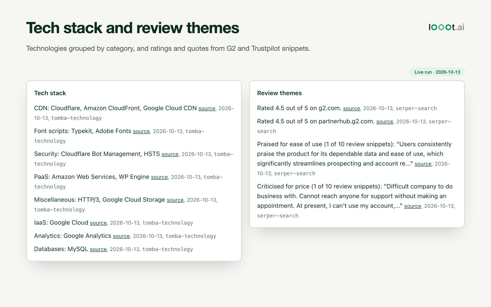</td>
</tr>
<tr>
<td>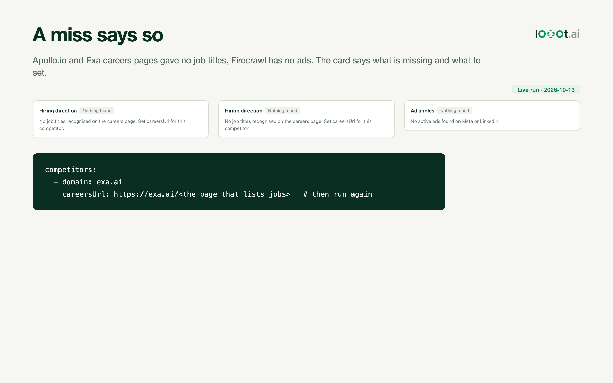</td>
<td>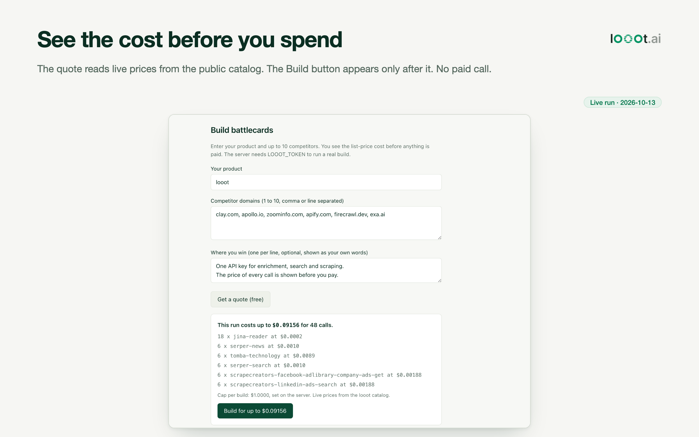</td>
</tr>
</table>

All six cards and the walkthrough are screenshots of the web UI running on the cards of a live paid run on 2026-10-13 (see [Live run](#live-run-looot-against-its-own-market)). They say "Live run · 2026-10-13". Ad text and any news title that names a person are replaced with a note in the images, nothing else is edited.

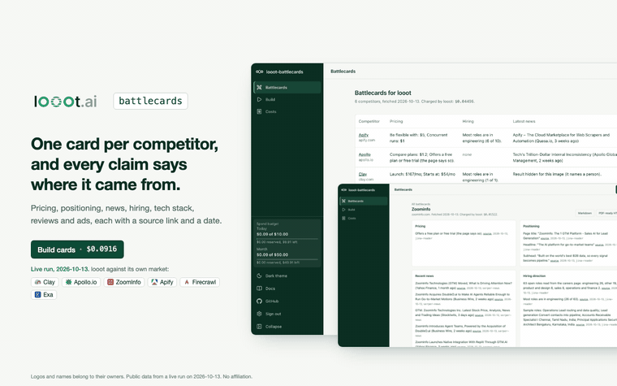

The same walkthrough as MP4: [docs/media/demo.mp4](docs/media/demo.mp4).

## Live run: looot against its own market

`npm run cards` with looot as the product and six neighbours as competitors: Clay, Apollo.io, ZoomInfo, Apify, Firecrawl and Exa. All 7 signals each. Config:

```yaml
product: { name: looot, domain: looot.ai }
competitors: [clay.com, apollo.io, zoominfo.com, apify.com, firecrawl.dev, exa.ai]
maxSpendUsd: 0.25
```

Two runs on 2026-10-13, three competitors first, then all six (the first three were replayed from the stored results and not charged again).

| | Result |
|---|---|
| Calls | 48 |
| Charged by looot | $0.0902 ($0.04525 and $0.04496) |
| Quote for all six | $0.09156 |
| Sections filled | 39 of 42 |

The calls were made while other jobs ran on the same looot balance, so `looot runs list` for that window shows more runs than these 48. The stored results match the quote line by line. 18 `jina-reader` and 6 `serper-news` runs in the list match this run exactly.

What the run showed, good and bad:

- Pricing, positioning, tech stack and reviews worked for all six. ZoomInfo's 63 open roles and G2 rating of 4.5 came back with sources.
- News is only as good as the name. Searching `"Clay"` returned obituaries and a high school football score, `"Exa"` returned a subsea cable company and a French industrial group, `"Apollo"` returned an asset manager and the space programme. Firecrawl, ZoomInfo and Apify news was on topic. Set `name:` in the config to something more specific than the bare brand.
- Ads have the same problem. The Meta library for "Clay" returned a hotel and parking offer in Dublin. ZoomInfo and Apify had LinkedIn ads only, Firecrawl had none.
- Pricing lines are rough. Apollo's page gave "Compare plans: $1.2" and Exa's gave "Free: $10", which are not plan prices. Apify's list mixes plans with proxy and compute rates. Check the source link before you quote a number.
- Hiring: Apollo.io and Exa returned no job titles from `/careers`, and the card says to set `careersUrl`. Clay's single "role" is a blog sentence about a product designer.

Run it yourself:

```bash
npm run cards -- --config battlecards.yaml --dry-run          # 48 calls, list price $0.09156
LOOOT_TOKEN=... npm run cards -- --config battlecards.yaml --max-spend 0.25
```

Demo data, the invented competitors of `npm run demo`:

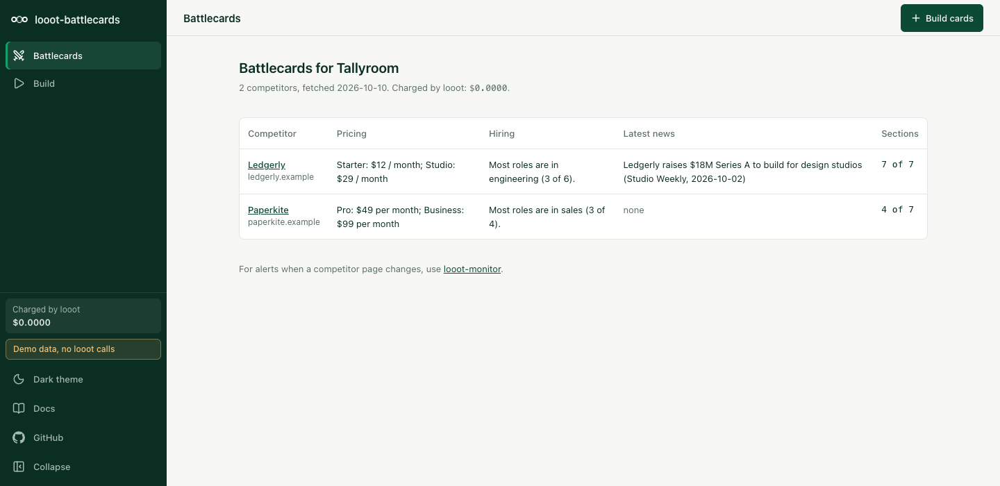

| Light | Dark |
| --- | --- |
| 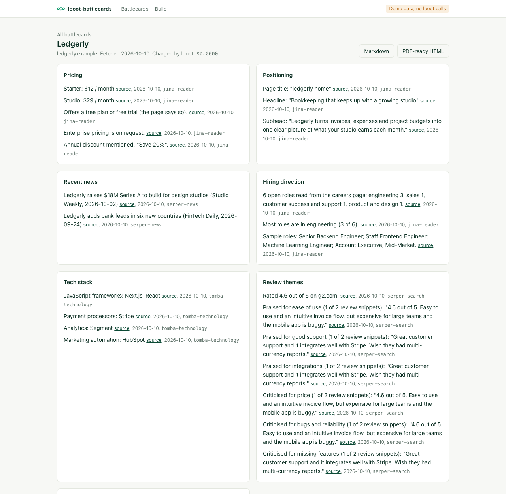 | 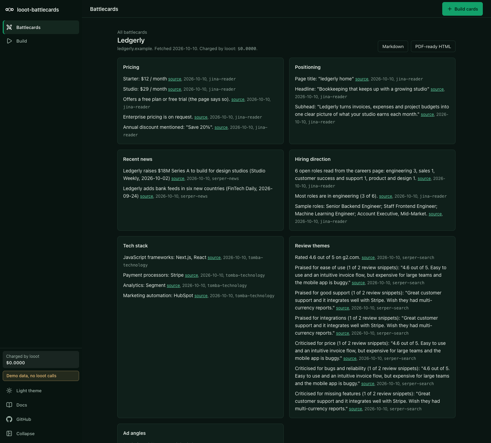 |

## What it does

- Reads 7 signals per competitor and keeps only what the page or result says. No claim is written from memory.
- Builds the card with templates and plain extraction rules. No LLM is needed. An optional summary step runs when `ANTHROPIC_API_KEY` is set and `--summary` is passed. The summary is stored apart from the sourced claims and labelled as model-written.
- Shows the list-price cost before any paid call, enforces a spend cap, and marks a section "pending", "failed" or "skipped" instead of hiding it.
- Exports each card to markdown and to a single HTML page with print styles, ready for "Save as PDF".
- Shows your own strengths on each card under "Where we win", marked as your words, never as fetched data.

## What you need

- Node 22.12 or newer. `package.json` has no `engines` field. Next.js 16 needs 20.9 or newer and the test runner (vitest 5) needs 22.12 or newer. I ran everything below on Node 24.
- npm. Nothing else for the demo and for `--dry-run`.
- A looot account and an agent token, only for a real run. Sign up at https://looot.ai/auth/sign-up. To get a token, run `npm i -g looot` and then `looot login`, which opens a browser approval. Or open the looot web app, go to Settings, "Agent tokens" and create one (https://docs.looot.ai/get-started/sign-in). With no browser, create the token there and `export LOOOT_TOKEN=...`.
- The token needs the scopes `runs.execute`, `catalog.read`, `runs.read` and `usage.read`.
- A funded balance. A run needs prepaid credit, the minimum top-up is $5, and signing up adds no credit (https://docs.looot.ai/money).
- Optional, an Anthropic API key for the model-written summary. Off by default.

There is no Supabase and no database in this repo. The web UI has one admin password that you set in the environment. The demo needs none.

## Try it in one minute

No account and no token.

```bash
git clone https://github.com/loootai/looot-battlecards.git
cd looot-battlecards
npm install --ignore-scripts
npm run demo
```

The web UI opens at http://localhost:3231 (`next dev -p 3231`) with invented competitors and no network calls. It has no sign-in and shows a "Demo, no sign-in" badge. `npm run demo` refuses to start while `LOOOT_TOKEN` is set, unless you also set an admin password. If port 3231 is busy, run `NEXT_PUBLIC_DEMO=1 npx next dev -p 3232`. For the same cards as files, run `npm run cards -- --demo`, which writes `cards/<domain>.json`, `.md`, `.html` and `cards/index.md` and prints `Charged by looot: $0.0000.`

## Run it with your own data

Copy the example env file. The web UI (Next.js) reads `.env.local`. The CLI does not read any env file, so load it into your shell first.

```bash
cp .env.example .env.local     # then put your token in LOOOT_TOKEN
set -a; source .env.local; set +a
```

| Variable | Required | What it does | Where to get it |
| --- | --- | --- | --- |
| `LOOOT_TOKEN` | Yes for a real run. Not needed for `--dry-run`, `--demo` or `npm run demo`. | The looot agent token. Server side only, never sent to the browser. | `looot login`, or Settings, "Agent tokens" in the looot web app |
| `LOOOT_API_URL` | Optional | looot API base URL. Default `https://api.looot.ai`. Also used when reading live prices. | Leave unset |
| `BATTLECARDS_ADMIN_PASSWORD` | Yes for the web UI outside the demo | Admin password, 12 characters or more. Without it the admin pages and API are closed and `/login` shows a setup page. The CLI does not need it. | Choose one |
| `BATTLECARDS_ADMIN_PASSWORD_HASH` | Alternative | `scrypt$salt$key` instead of the plain password. Wins if both are set. | `npm run hash-password -- 'your password'` |
| `BATTLECARDS_SESSION_SECRET` | Optional | Key that signs session cookies. Default: derived from the password, so changing the password signs everyone out. | `openssl rand -hex 32` |
| `BATTLECARDS_COOKIE_SECURE` | Optional | Set `0` to drop the Secure flag in production, only for plain-http testing. | Leave unset |
| `BATTLECARDS_MAX_SPEND_USD` | Optional | Spend cap for one web build, default `1`. The caller cannot change it. | Choose one |
| `CARDS_DIR` | Optional | Folder where the web UI reads and writes cards. Default `./cards`. The CLI uses `--out` instead. | Any folder you own |
| `NEXT_PUBLIC_DEMO` | Optional | `1` shows the invented demo data and blocks every looot call. `npm run demo` sets it for you. | Do not set it for real runs |
| `ANTHROPIC_API_KEY` | Optional | Turns on the model-written summary when you pass `--summary`. Without it `--summary` prints a notice and builds the cards without a summary. | https://console.anthropic.com |
| `BATTLECARDS_LLM_MODEL` | Optional | Model for the summary. Default `claude-sonnet-5-5`. | Your Anthropic account |

Put your product and competitors in a YAML file.

```bash
cp battlecards.example.yaml battlecards.yaml    # then edit it
```

`battlecards.example.yaml` has an invented product (Tallyroom) and two invented competitors (domains end in `.example`). Per competitor you can set `pricingUrl` and `careersUrl` when those pages are not at `/pricing` and `/careers`. `signals` limits which of the seven signals run. You can skip the file with `--product "Acme" --competitors a.com,b.com`.

Price first. A dry run needs no token and makes no call. It uses the list prices dated 2026-10-10. This is the real output of `npm run cards -- --config battlecards.example.yaml --dry-run`:

```text
Plan: 2 competitor(s), 16 calls, list price $0.03052 (list prices dated 2026-10-10). Cap $0.2500.
    6 x jina-reader  $0.0002
    2 x serper-news  $0.0010
    2 x tomba-technology  $0.0089
    2 x serper-search  $0.0010
    2 x scrapecreators-facebook-adlibrary-company-ads-get  $0.00188
    2 x scrapecreators-linkedin-ads-search  $0.00188
Dry run: no looot call was made and nothing was written.
```

Then the real run. The example domains are invented, so put your own competitors in the file first:

```bash
npm run cards -- --config battlecards.yaml --max-spend 0.25
```

Options: `--signals pricing,news`, `--out cards`, `--summary`, `--max-spend <usd>`, `--fresh <tag>`, `--partial`. Before it runs, the CLI reads live prices from the catalog and prints the plan again. Output goes to `cards/<domain>.json`, `.md`, `.html` and `cards/index.md`, plus `cards/product.json`. Open a `.html` file and use Print, Save as PDF. The CLI exits with 2 on bad input or a missing token, and with 1 only when every section of every card failed.

Web UI on live data. Load your token as above and run `npm run dev`, then open http://localhost:3000/build. Press "Get a quote (free)", then "Build for up to ...". The build button appears only after a quote. The server refuses with a 409 if the confirmed maximum is below the quote, or if the quote token from the quote step is missing, expired or for different input. The spend cap is `BATTLECARDS_MAX_SPEND_USD` on the server (default $1). Nothing in a request can change it. Cards are written to `CARDS_DIR`. The UI needs the admin password, see [Securing a deployment](#securing-a-deployment).

## Spending

looot shows the price before each paid action, and so does this repo. The CLI prints the plan with `--dry-run` or before a run, and the UI shows the quote before the Build button appears. A competitor costs about $0.015 at list prices, so $0.0763 for 5 and $0.153 for 10 (all 7 signals). Failed calls are not charged by looot.

Four limits stand between a request and a charge, checked in this order: the quote, the cap per run, the period budget, then the call.

- The quote is printed first. The cap per run is `--max-spend` in the CLI (default $1.00, or `maxSpendUsd` in the config file) and `BATTLECARDS_MAX_SPEND_USD` on the server for the web UI (default $1; the page shows it and cannot change it). A cap in a request body is ignored.
- The period budget caps all builds together: a daily and a monthly amount (UTC), $10 and $50 until you change them. The owner changes them on the Costs page of the web UI, or sets the starting values with `LOOOT_BATTLECARDS_DAILY_USD` and `LOOOT_BATTLECARDS_MONTHLY_USD`. A request to `/api/build` cannot carry a budget: one with a budget field is refused with 400. The CLI refuses a run whose chargeable quote is above what is left, unless you pass `--partial`.
- Before each paid call the app reserves its list price in `budget.json` (in `LOOOT_BATTLECARDS_DATA_DIR`, default `.looot-data`), under a lock file, and refuses the call if used plus reserved plus the price would pass the daily or the monthly budget. Two builds started together cannot both pass. When the call ends the reservation becomes the real charge. A call looot refused with an HTTP answer releases it. A call still running at looot (`pending`) keeps its reservation: it is never recorded as failed at $0 and the budget is never handed back early.
- The next build looks up every pending call with `GET /v1/runs/{id}` and settles the ones that ended, to their real cost. If looot cannot be reached, or the app died before it got a run id, the reservation stays for 24 hours and is then released.
- The sidebar and the Costs page show used, reserved and remaining for today and this month. At the budget the build is refused with a message that names the limit.
- Every call has a stable key made from the competitor, the signal, the endpoint and the normalised input. No date or time goes in, and no call input carries one (the news search uses the relative window `qdr:m`). A finished call is stored in `budget.json` for 40 days. Repeating the same request is answered from the stored result: no call, no charge, and the up-front budget check ignores it.
- Cards are reused for a refresh window of 7 days (`floor(time / 7 days)` is part of the key). The first build in a new window is an explicit new request with its own key. `--fresh <tag>` in the CLI looks again inside a window, once per tag.
- The looot token balance is the final limit. Fund a dedicated token with only what you are willing to spend, and keep the budget below it.

The budget lives in a file, so run one instance on a disk that persists. Several instances, or a serverless host with a throwaway disk, do not share it.

| Section | looot job | Endpoint | List price per call | What the extractor reads |
| --- | --- | --- | --- | --- |
| Pricing | `web.scrape.markdown` | `jina-reader` on `/pricing` | $0.0002 | plan names, prices, free tier, "contact sales", annual discount |
| Positioning | `web.scrape.markdown` | `jina-reader` on `/` | $0.0002 | page title, first headline, first full sentence |
| Hiring direction | `web.scrape.markdown` | `jina-reader` on `/careers` | $0.0002 | job titles counted by function |
| Recent news | `news.search` | `serper-news` | $0.0010 | five newest items with outlet and date |
| Review themes | `google.serp.organic` | `serper-search` limited to G2, Trustpilot and Capterra | $0.0010 | ratings and praise or complaint themes from the snippets |
| Tech stack | `company.technographics` | `tomba-technology` | $0.0089 | technologies grouped by category |
| Ad angles | `ads.meta.search`, `ads.linkedin.search` | `scrapecreators-facebook-adlibrary-company-ads-get`, `scrapecreators-linkedin-ads-search` | $0.00188 each | ad text, angles by keyword rules |

Prices are list prices read from the free public catalog on 2026-10-10. A real run re-reads them first and refuses to call an endpoint whose live price it cannot read.

Dropped, because looot has no provider for it: win-loss interviews, CRM and call-recording insights, and a Slack or CRM publishing step. Google Ads are not read: the cheapest provider is $0.0064 a call and the Meta and LinkedIn libraries cover most B2B ad angles. For ongoing alerts when a competitor page changes, use [looot-monitor](https://github.com/loootai/looot-monitor). This repo does not rebuild it.

Rules the code enforces.

- The quote comes first. The CLI prints it with `--dry-run`, the UI shows it before the Build button appears.
- The spend cap and the period budget are checked against list prices before each call. A call that would pass either is skipped and never sent.
- Each call carries a stable idempotency key made from the competitor, the signal, the endpoint, the normalised input and the 7-day refresh window. Running the same input again is answered from the stored result and charges nothing more. `--fresh <tag>` changes the key when you want a new build.
- A run that is still going when waiting stops (60 seconds) is "pending", not "failed". It keeps its reservation in the period budget until it ends. Failed calls are not charged by looot.

## Securing a deployment

Versions 0.1.3 and older had no admin authentication. From 0.1.4 every route is either public on purpose or admin, and the admin routes are closed unless you set a password. The CLI is not affected, it never opens a port.

### Route map

Pages and routes were listed from `src/app` and classified. A test reads the folder and fails if a route is missing from `src/lib/auth/routes.ts` or if an admin route does not call the gate.

| Class | Count | Routes |
| --- | --- | --- |
| Public by design | 4 routes | `/api/health`, `/login`, `/api/auth/login`, `/api/auth/logout` |
| Public static files | 2 | `/favicon.ico`, `/brand/*` |
| Admin pages | 4 | `/` (cards), `/build`, `/card/[domain]`, `/costs` (budget and cost) |
| Admin API | 4 | `/api/quote` (free), `/api/build` (paid looot run), `/api/budget` (read, and change the period budget), `/api/export/[domain]` (downloads a card) |

There are no server actions and no webhooks. Any path not listed is treated as admin.

### How the gate works

- `src/proxy.ts` checks every request. Each admin page, the root layout and each admin route handler checks again with the same function, so a path the matcher misses is still closed.
- Not set up (no password, and not a clean demo): admin routes answer 503, admin pages redirect to `/login`, which says what to set. Nothing stored is rendered.
- Set up: a valid session is required. Page requests without one redirect to `/login`. API requests get 401.
- Sign-in: constant-time password comparison. A session is a signed token in an httpOnly, SameSite=Lax cookie, Secure in production, valid for 8 hours. 5 wrong passwords from one address lock that address for 15 minutes. 40 wrong passwords from anywhere lock sign-in for everyone for 15 minutes, so use a long password and an IP allow-list too.
- State-changing admin requests need a same-origin `Origin` header and the per-session token in `x-battlecards-csrf`. The layout puts the token in a meta tag and the build form sends it.
- Admin responses carry `Cache-Control: no-store`, and so do card downloads. All responses carry a Content-Security-Policy (`frame-ancestors 'none'`), `X-Frame-Options: DENY`, `X-Content-Type-Options: nosniff` and `Referrer-Policy: no-referrer`. The CSP allows inline scripts because Next.js needs them.
- The password and token never reach the client bundle. The server reads them at runtime.

### Spending

- The cap for a web build is `BATTLECARDS_MAX_SPEND_USD` on the server, default $1. A `maxSpendUsd` in a request is ignored. The quote shows the cap.
- `/api/build` runs only with the token that `/api/quote` issued to the same session for the same product, strengths, competitors and signals, within 10 minutes. It also needs a confirmed maximum at or above the live quote. The spend is the lower of the cap and the confirmed maximum.
- Per session: 6 builds an hour and 30 quotes every 10 minutes, then 429 with `Retry-After`. The counters live in memory, so behind several instances also rate limit at the proxy.
- Product names are capped at 100 characters, strengths at 10 lines of 200 characters, competitors at 10.
- The period budget (`PUT /api/budget`) is changed only by the signed-in owner, with the CSRF token. A build request cannot raise it, and one that carries a budget field is refused. See [Spending](#spending). The budget file needs one instance on a persistent disk. The looot token balance is the final limit, so give the app a token funded with only what you are willing to spend.
- The web build never calls Anthropic. Only the CLI does, with `--summary`.

### Setup

```bash
export BATTLECARDS_ADMIN_PASSWORD='a password of 12 or more characters'
# or keep it out of the environment as plain text:
npm run hash-password -- 'a password of 12 or more characters'   # prints BATTLECARDS_ADMIN_PASSWORD_HASH=...
```

Rotate the password by changing the variable and restarting. Changing it signs every session out. Cards are plain files in `CARDS_DIR` on the server's disk, so protect and back them up like any file with business data.

### The stronger option

A shared password is the floor. For anything people other than you can reach, put the app behind a VPN, a private network or an identity-aware proxy (Cloudflare Access, Tailscale, Google IAP, oauth2-proxy) and keep the password on as well.

### Not covered

No per-user accounts, no roles, and no log of who signed in. The app has one admin.

## Deploy

This repo has no `vercel.json` and no GitHub workflow. The web UI writes cards to a folder (`CARDS_DIR`, default `./cards`), which Vercel does not keep between requests and may not let you write, so run it on your own machine or a server with a disk. If you still import it into Vercel, set `BATTLECARDS_ADMIN_PASSWORD` (the app serves no admin route without it), `LOOOT_TOKEN`, and `ANTHROPIC_API_KEY` only if you want summaries, as environment variables. The saved cards will not last. The CLI needs no deploy. To run it on a schedule, call it from cron or your own CI with `LOOOT_TOKEN` set.

## Troubleshooting

| What you see | Cause and fix |
| --- | --- |
| `LOOOT_TOKEN is not set. Create an agent token at https://looot.ai/settings, or use --demo or --dry-run.` | The CLI found no token. Run `set -a; source .env.local; set +a` or `export LOOOT_TOKEN=...`. The token page is Settings, "Agent tokens" in the looot web app. Exit code 2. |
| `Admin sign-in is not set up.` (HTTP 503, or the setup page at `/login`) | Set `BATTLECARDS_ADMIN_PASSWORD` to 12 or more characters and restart. |
| `Get a quote for this exact request first.` (HTTP 409 from `/api/build`) | The quote token is missing, expired (10 minutes) or for different input. Press "Get a quote" again. |
| `LOOOT_TOKEN is not set on the server.` (HTTP 503 from the web UI) | Put `LOOOT_TOKEN` in `.env.local` and restart `npm run dev`. |
| `Demo mode makes no looot call and writes nothing. Run without NEXT_PUBLIC_DEMO to build real cards.` | You started with `npm run demo`. Use `npm run dev`. |
| A section shows "Failed" or "Skipped" with the looot error text as its note | The text comes from the looot API. A 401 means the token is wrong, revoked or lacks a scope (it needs `runs.execute`, `catalog.read`, `runs.read`, `usage.read`). A balance error means the account has no credit, so top up at https://docs.looot.ai/money. Failed calls cost nothing. |
| `The spend cap would be passed.` | The call was skipped and not sent. Raise `--max-spend` if you accept the price. |
| `The live price could not be read.` | The catalog price for that endpoint could not be read, so the call was skipped. Try again, or check `LOOOT_API_URL`. |
| `Still queued when waiting stopped. Read run <id> later.` (the status word can differ) | The section is pending. Run the same command again. Its budget stays reserved, the next run settles it, and the stored run is replayed and not charged twice. |
| `No prices found on the page. It may load prices with scripts or sit at another URL. Set pricingUrl for this competitor.` | The page came back empty as markdown. Set `pricingUrl` in the config. |
| `No job titles recognised on the careers page. Set careersUrl for this competitor.` | Set `careersUrl` in the config. |
| `The call worked but nothing readable came back.` | The call succeeded but the parser read no claims. Either the data is not there, or the response has a shape the parser does not know. See Status. |
| `--summary needs ANTHROPIC_API_KEY. Cards were built without it.` | Set `ANTHROPIC_API_KEY`. If the summary call fails the card is kept without a summary and no message is shown. |
| `Every section failed.` | Exit code 1. Read the notes in `cards/index.md`. Usually the token or balance. |
| `Give 1 to 10 competitors.`, `"x" is not a domain.`, `Unknown signal "x". Known: ...`, `--max-spend must be a positive number of dollars.` | Fix the config or flags. Exit code 2. |

How to file an issue. Open an issue at https://github.com/loootai/looot-battlecards/issues with the run id (a pending note prints it; otherwise give the endpoint id and the time of the call), the command you used, and the raw response body with secrets removed. The `.json` card shows each section's status and note.

## Status

One paid looot run was made on 2026-10-13 (see Live run). Parsing for `jina-reader` pages, `tomba-technology` and the two ad libraries was written from the docs and hand-written fixtures, and the run showed it works on real pages but picks up noise: see the pricing and hiring notes above. If a section comes back empty or wrong, open an issue with the raw response (see Troubleshooting). Pricing and careers extraction depends on the page being readable as markdown: pages that load prices with scripts come back empty, and the card says so. Review themes are keyword rules on search snippets, which is a weak signal, and the card quotes the snippet so you can judge it. All demo brands are invented.


## Develop

```bash
npm test && npm run typecheck && npm run lint && npm run build
npm run leak-scan
git config core.hooksPath .githooks
```

## Install for agents

- Read [llms.txt](llms.txt).
- Claude Code skill: copy `skills/battlecards` to `~/.claude/skills/battlecards`. It prices the run, asks for a yes, runs the CLI and reports gaps as they are.
- Requires an agent token in `LOOOT_TOKEN`. See "What you need".

## Licence

MIT, copyright looot.

## Related

Other open-source projects built on [looot](https://looot.ai):

- [looot-intent](https://github.com/loootai/looot-intent): account intent and buying-stage scoring (6sense)
- [looot-score](https://github.com/loootai/looot-score): lead and ICP fit scoring (MadKudu)
- [looot-reveal](https://github.com/loootai/looot-reveal): which companies visit your site (RB2B, Clearbit Reveal)
- [looot-techstack](https://github.com/loootai/looot-techstack): website technologies from several providers (BuiltWith, Wappalyzer)
- [looot-signals](https://github.com/loootai/looot-signals): hiring, funding and news triggers (TheirStack, Harmonic)
- [looot-lookalike](https://github.com/loootai/looot-lookalike): lookalike company search (Ocean.io)
- [looot-ads](https://github.com/loootai/looot-ads): competitor ad board (Foreplay)
- [looot-reviews](https://github.com/loootai/looot-reviews): review themes and weak spots (ReviewTrackers)
- [looot-mentions](https://github.com/loootai/looot-mentions): brand and keyword listening (Brand24)
- [looot-warm-leads](https://github.com/loootai/looot-warm-leads): warm leads from LinkedIn intent signals (Gojiberry)
- [looot-crm](https://github.com/loootai/looot-crm): a small CRM with buying signals built in
- [looot-seo](https://github.com/loootai/looot-seo): self-hosted SEO workspace
- [looot-monitor](https://github.com/loootai/looot-monitor): brand and competitor monitoring with alerts
